# Scroll Sketch

**Hand-drawn charts that draw themselves as your reader scrolls.** For newsletters, blogs and explainers, with GIF export for email.

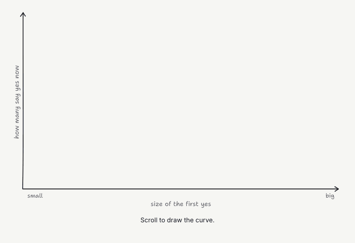

Each chart pins on screen while the reader scrolls, and the scroll drives the story: a line draws, dots drop in, a label changes, an arrow makes the point. It looks sketched on a notepad, which makes a business argument feel like a conversation rather than a report.

Scroll Sketch gives you:

- **12 starter templates**, one for each common business story shape, each with its whole story in one editable block
- **A tiny library** (under 200 lines) on top of [Rough.js](https://roughjs.com), with no build step and no framework
- **GIF export** for email, where scripts can't run: every chart becomes a looping GIF that links to the live page
- **A Claude skill**, so you can say "turn this newsletter section into a scroll chart" and get a checked, finished page

## The templates

| | |
|---|---|
| **01 · Curve shift**: items slide along a curve to a better spot<br> | **02 · Quadrant move**: an item changes quadrant on a 2×2<br>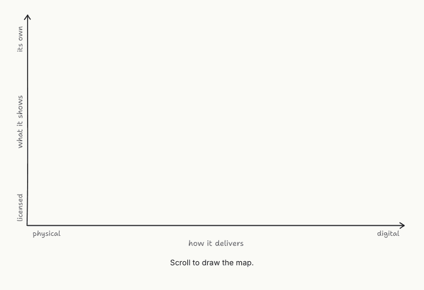 |
| **03 · Count up**: a dot grid fills, then the maths<br>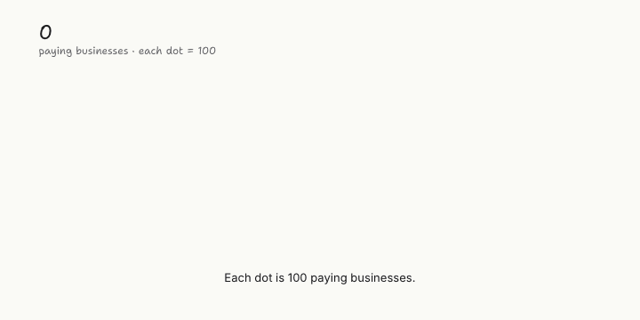 | **04 · Before / after**: bars grow, then one collapses<br>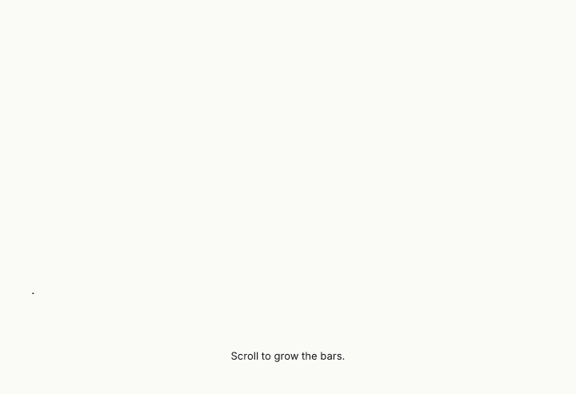 |
| **05 · Flow reroute**: the old route, then a new one<br>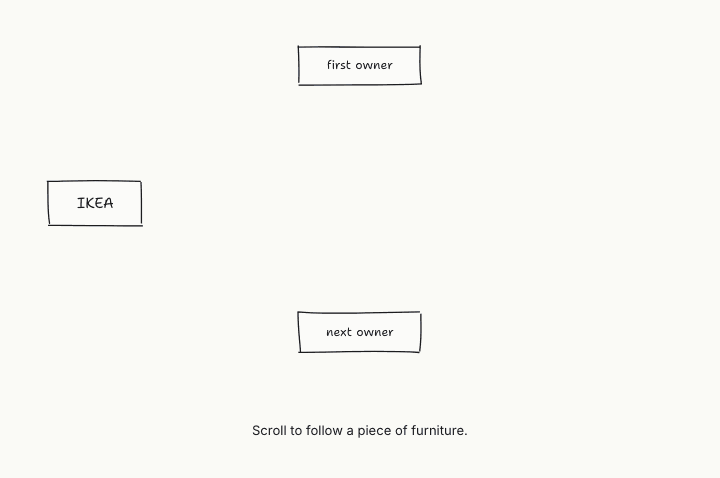 | **06 · Timeline**: milestones, then a phase<br>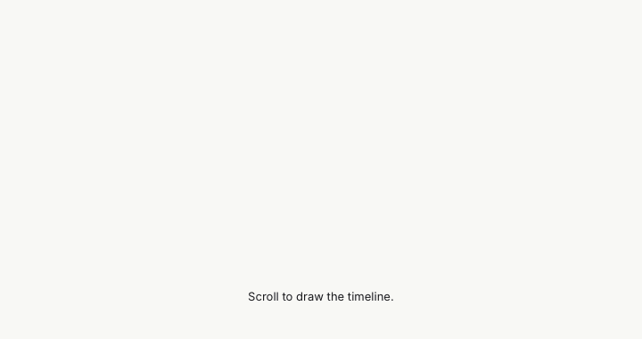 |
| **07 · Funnel**: where people drop out<br>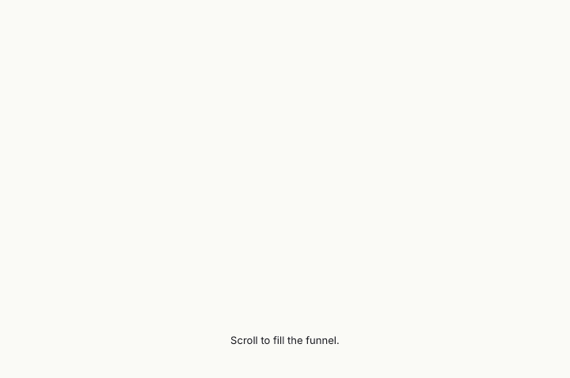 | **08 · Flywheel**: a loop that feeds itself<br>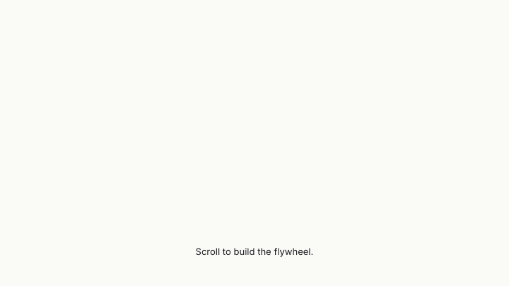 |
| **09 · S-curve jump**: the next curve rises past the first<br>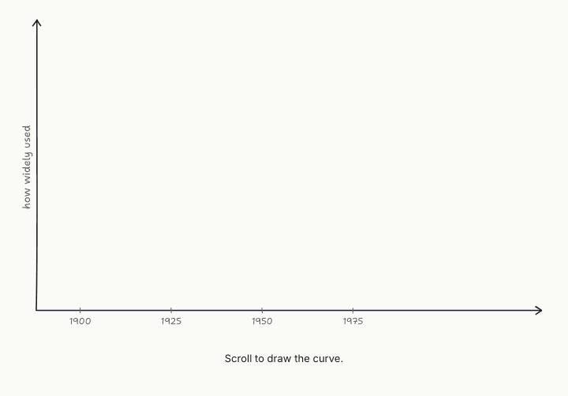 | **10 · Waterfall**: where the money goes<br>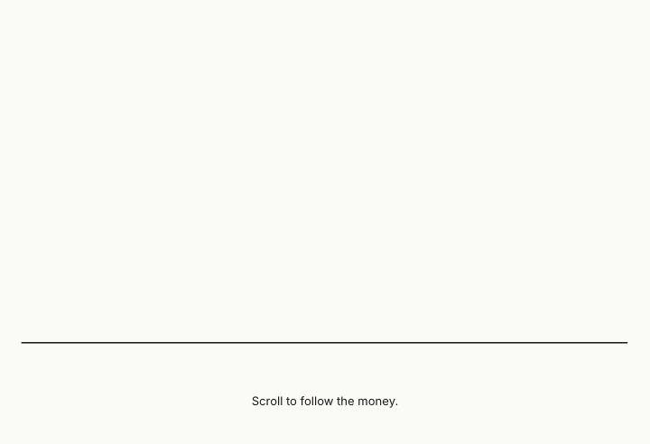 |
| **11 · Market size**: TAM, SAM, SOM<br>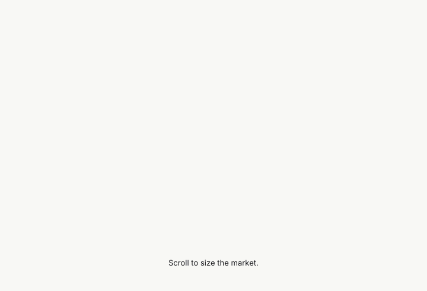 | **12 · Break-even**: when it starts to pay<br>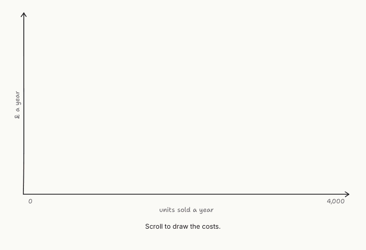 |

Templates live in [`skills/scroll-sketch/templates/`](skills/scroll-sketch/templates). [Which one fits your story?](skills/scroll-sketch/references/story-shapes.md)

## Quick start

### With Claude Code
```
/plugin marketplace add Somebrainfuel/scroll-sketch
/plugin install scroll-sketch@scroll-sketch
```
Then ask, for example: *"Turn the second section of my newsletter into a scroll chart, and make GIFs for the email."*

### With Claude.ai or the Claude desktop app
Download `scroll-sketch-skill.zip` from the [latest release](https://github.com/Somebrainfuel/scroll-sketch/releases/latest) and upload it under **Settings → Capabilities → Skills**.

### By hand
1. Clone the repo and open a template from `skills/scroll-sketch/templates/` in your browser.
2. Edit the `STORY` block at the bottom of the file: labels, numbers, positions (0 to 1), captions and timing. Reload to see it.
3. Make it one file for publishing:
   ```bash
   python3 skills/scroll-sketch/scripts/bundle.py my-chart.html my-chart.single.html
   ```
   Use `--fragment` to paste it into a WordPress *Custom HTML* block.

## GIFs for email
```bash
node skills/scroll-sketch/scripts/capture.mjs my-chart.html frames/
python3 skills/scroll-sketch/scripts/make_gif.py frames/ gifs/
```
You get one looping GIF (1100px wide, usually under 3 MB) and one poster image per chart. Show it at about 600px in the email and link it to the live page. Needs Node 22+, Chrome or Chromium, and Python with Pillow. [Publishing guide](skills/scroll-sketch/references/publishing.md).

## Make it yours
The look is set by a few CSS variables. Load a theme file after the stylesheet to change colours and fonts; [`business-design-labs.css`](skills/scroll-sketch/lib/themes/business-design-labs.css) is an example. Keep the accent colour for lines and shapes, and text in ink or muted, so labels stay readable whatever your brand colour.

## Examples
- [**New Combinations, Issue 1**](examples/new-combinations-issue-1/): a full newsletter issue told as three scroll charts, with its email GIFs.
- [**How it works**](examples/how-it-works.html): a teardown of the technique, with a Rough.js playground.

## Wanted
Templates people have asked for that aren't in the bank yet: positioning map, line race, line and rise, split the whole, unbundle, combination (Venn), canvas fill. Pull requests welcome: copy the nearest template, keep the `STORY` block convention, and add a preview GIF.

## Credits
Inspired by Ben Tossell's ["Ramp has taste"](https://www.bensbites.com/p/how-i-got-seduced) in Ben's Bites. Built on [Rough.js](https://github.com/rough-stuff/rough) (MIT) and the [Shantell Sans](https://fonts.google.com/specimen/Shantell+Sans) typeface (SIL Open Font License). Made by Gary Fox.

## Licence
[MIT](LICENSE)
